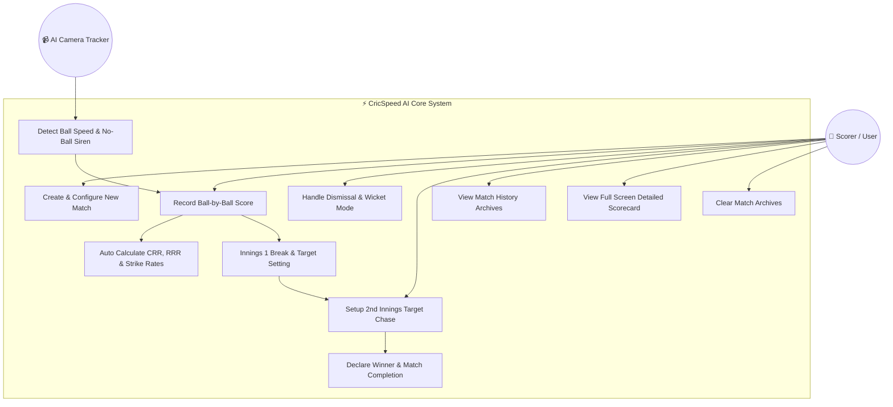
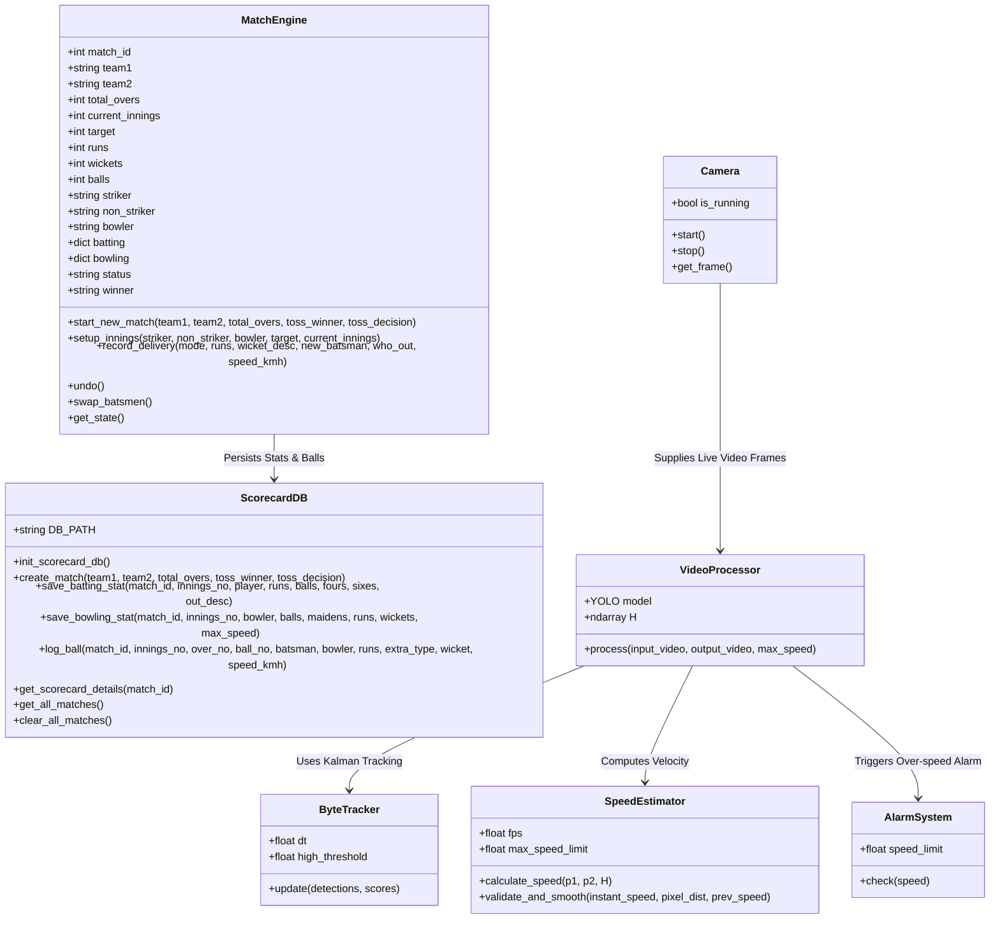
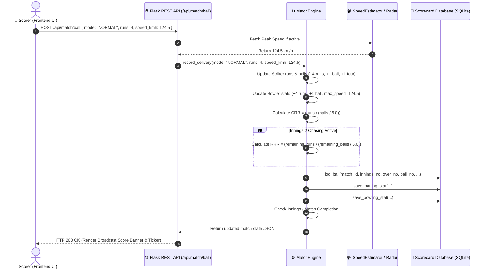

# CricSpeed AI — Project Architecture & UML Diagrams

This document contains complete UML design diagrams for the **CricSpeed AI** Cricket Live Scorecard & Computer Vision Velocity Radar System. 

You can use the provided **Mermaid code blocks** directly in your project report, slides, or render them using [Mermaid Live Editor](https://mermaid.live) or Draw.io.

---

## 1. Use Case Diagram

The Use Case Diagram illustrates the functional interactions between the **Scorer / User**, **Camera Tracker System**, and the **CricSpeed AI Core Engine**.

---

## 2. Class Diagram

The Class Diagram highlights the Object-Oriented Software Architecture of CricSpeed AI, connecting the **Flask REST API**, **MatchEngine**, **Database Helper**, and **AI Computer Vision** modules.

---

## 3. Sequence Diagram

This diagram shows the exact chronological execution flow when a Scorer inputs a delivery (or AI camera detects speed), updates match state, recalculates CRR/RRR, logs to SQLite, and updates the UI.

---

## 4. Activity Diagram

The Activity Diagram captures the complete operational workflow of a Cricket Match in CricSpeed AI—from setup through Innings 1, Innings Break, Innings 2 Target Chase, and Winner Declaration.

```mermaid
stateDiagram-v2
    [*] --> MatchInitialization : Scorer launches New Match

    state MatchInitialization {
        [*] --> InputTeamsAndOvers
        InputTeamsAndOvers --> SelectTossWinner
        SelectTossWinner --> InputOpeningPlayers
    }

    MatchInitialization --> Innings1Scoring : Innings 1 Started

    state Innings1Scoring {
        [*] --> AwaitDeliveryInput
        AwaitDeliveryInput --> ProcessBall : Normal / Extra / Wicket Input
        ProcessBall --> LogBallAndStats
        LogBallAndStats --> CheckInnings1Over : Overs >= Total Overs OR Wickets >= 10?
        CheckInnings1Over --> AwaitDeliveryInput : No
    }

    Innings1Scoring --> InningsBreak : Innings 1 Overs/Wickets Complete

    state InningsBreak {
        [*] --> SetTargetRuns : Target = (Innings 1 Runs) + 1
        SetTargetRuns --> ShowInnings1Summary
        ShowInnings1Summary --> Await2ndInningsSetup
    }

    InningsBreak --> Innings2Scoring : Scorer configures 2nd Innings

    state Innings2Scoring {
        [*] --> ChasingTarget
        ChasingTarget --> RecordInnings2Delivery
        RecordInnings2Delivery --> CheckTargetReached : Runs >= Target?
        CheckTargetReached --> TargetAchieved : Yes (Batting Team Wins)
        CheckTargetReached --> CheckOversFinished : No -> Overs >= Total Overs OR Wickets >= 10?
        CheckOversFinished --> BowlingTeamWins : Yes
        CheckOversFinished --> ChasingTarget : No
    }

    TargetAchieved --> MatchCompleted
    BowlingTeamWins --> MatchCompleted

    state MatchCompleted {
        [*] --> DeclareWinner
        DeclareWinner --> ArchiveToDatabase
        ArchiveToDatabase --> ViewHistoryAndScorecard
    }

    MatchCompleted --> [*]
```

