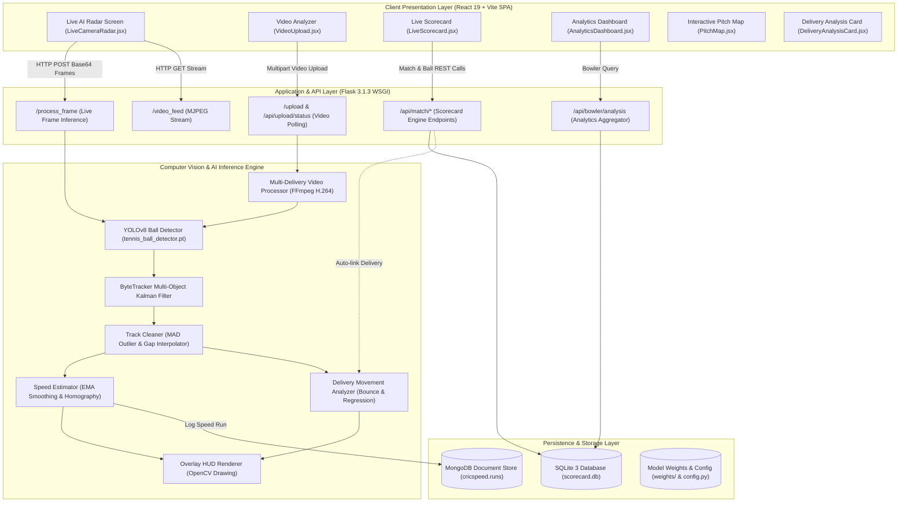
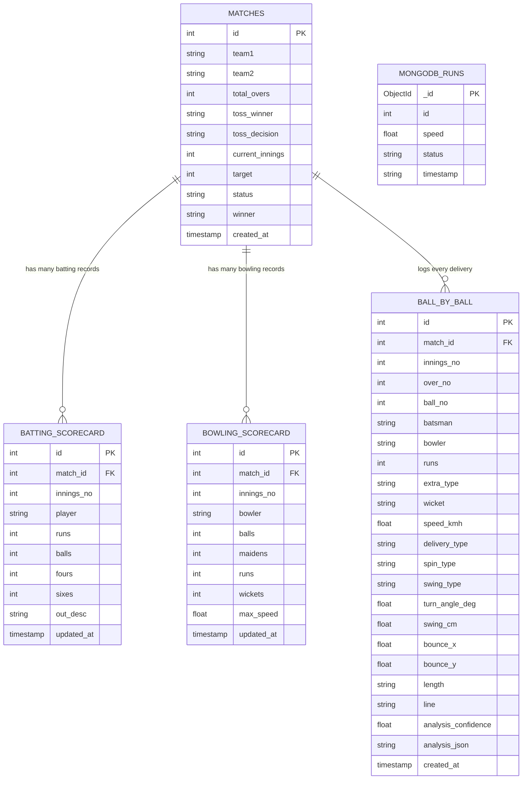

# CRICSPEED AI: COMPUTER VISION & AI-POWERED CRICKET BOWLING SPEED RADAR & MOVEMENT ANALYTICS SYSTEM

---

# A MINI-PROJECT REPORT

*Submitted in partial fulfillment of the requirements for the award of the degree of*

**BACHELOR OF TECHNOLOGY / BACHELOR OF ENGINEERING**  
**IN**  
**COMPUTER SCIENCE AND ENGINEERING / INFORMATION TECHNOLOGY**

---

## TABLE OF CONTENTS

- [CHAPTER 1: INTRODUCTION](#chapter-1-introduction)
  - [1.1 Perspective](#11-perspective)
  - [1.2 Objective](#12-objective)
  - [1.3 Scope](#13-scope)
- [CHAPTER 2: REQUIREMENT DESCRIPTION](#chapter-2-requirement-description)
  - [2.1 Functional Requirements](#21-functional-requirements)
  - [2.2 Non-Functional Requirements](#22-non-functional-requirements)
- [CHAPTER 3: SYSTEM DESIGN](#chapter-3-system-design)
  - [3.1 Architecture Design](#31-architecture-design)
  - [3.2 Design Components](#32-design-components)
    - [3.2.1 Front End Architecture](#321-front-end-architecture)
    - [3.2.2 Back End Architecture](#322-back-end-architecture)
    - [3.2.3 Database Design](#323-database-design)
- [CHAPTER 4: SYSTEM IMPLEMENTATION](#chapter-4-system-implementation)
  - [4.1 Environment and Toolchain](#41-environment-and-toolchain)
  - [4.2 Implementation Details of Core Modules](#42-implementation-details-of-core-modules)
    - [4.2.1 Object Detection and Tracking Engine](#421-object-detection-and-tracking-engine)
    - [4.2.2 Trajectory Cleaning and Outlier Rejection](#422-trajectory-cleaning-and-outlier-rejection)
    - [4.2.3 Speed Estimation and Coordinate Homography](#423-speed-estimation-and-coordinate-homography)
    - [4.2.4 Bounce Detection and Angular Regression Analysis](#424-bounce-detection-and-angular-regression-analysis)
    - [4.2.5 Batter Handedness Dynamic Inversion](#425-batter-handedness-dynamic-inversion)
    - [4.2.6 OpenCV Broadcast HUD Rendering & Video Transcoding](#426-opencv-broadcast-hud-rendering--video-transcoding)
    - [4.2.7 Match Engine & Scorecard Rule Implementation](#427-match-engine--scorecard-rule-implementation)
- [CHAPTER 5: RESULTS AND DISCUSSION](#chapter-5-results-and-discussion)
  - [5.1 Testing and Experimental Validation](#51-testing-and-experimental-validation)
  - [5.2 Visualizations and System Outputs](#52-visualizations-and-system-outputs)
  - [5.3 Viva Voce Preparation & Technical Discussion](#53-viva-voce-preparation--technical-discussion)
- [CHAPTER 6: CONCLUSION AND FUTURE ENHANCEMENTS](#chapter-6-conclusion-and-future-enhancements)
  - [6.1 Conclusion](#61-conclusion)
  - [6.2 Future Enhancements](#62-future-enhancements)
- [APPENDICES](#appendices)
  - [Appendix A: Installation and Deployment Manual](#appendix-a-installation-and-deployment-manual)
  - [Appendix B: REST API Specification Matrix](#appendix-b-rest-api-specification-matrix)
  - [Appendix C: Configuration Parameters Reference](#appendix-c-configuration-parameters-reference)

---

# CHAPTER 1: INTRODUCTION

## 1.1 Perspective

Cricket is one of the most widely played and analytically scrutinized team sports in the world. In contemporary professional cricket, high-precision telemetry—including release speed, pitch bounce point, lateral swing deviation, and turn angle off the surface—forms the backbone of tactical performance coaching, player recruitment, and broadcast television commentary. High-end proprietary ball-tracking systems, such as Hawk-Eye and Virtual Eye, utilize multi-camera synchronized arrays (typically six to ten industrial 340 FPS cameras calibrated stereoscopically around the perimeter of the stadium) paired with specialized millimeter-wave radar speed guns (e.g., Stalker Sport radars). While these commercial systems deliver sub-millimeter trajectory accuracy, their capital expense (often exceeding hundreds of thousands of dollars per installation) and severe operational complexity render them entirely inaccessible to grassroots sports academies, collegiate cricket teams, domestic clubs, and amateur athletes.

This financial and logistical barrier creates a profound technological divide in sports science. Aspiring bowlers at school, collegiate, and regional club levels frequently train in practice nets without objective, empirical feedback on their bowling velocity or movement mechanics. Coaches are forced to rely on subjective visual estimation, which fails to capture fine-grained physical dynamics such as late inswing versus off-cutters, release-to-bounce flight angles, or subtle shifts in delivery release speeds. 

**CricSpeed AI** directly resolves this disparity by introducing a fully autonomous, monocular computer vision and artificial intelligence pipeline capable of extracting broadcast-grade bowling analytics from a **single standard camera sensor** (such as an affordable action camera, USB webcam, or smartphone). By fusing state-of-the-art single-stage convolutional object detection (YOLOv8), Kalman-filter-based multi-object spatial tracking (ByteTrack), robust trajectory noise filtering, vertical velocity inflection bounce identification, and planar homography perspective transformation, CricSpeed AI measures:
- Real-time bowling velocity in kilometers per hour ($\text{km/h}$);
- Exact two-dimensional pitch bounce impact coordinates;
- Post-bounce spin turn angle ($\Delta \theta$ in degrees);
- In-flight aerodynamic seam swing (lateral deviation in centimeters);
- Pitch length categorization (Yorker, Full, Good Length, Short) and line classification (Outside Off, Off Stump, Middle, Leg Stump, Outside Leg);
- Batter handedness adaptation (Right-Hand Batsman vs. Left-Hand Batsman).

Furthermore, the platform integrates these computer vision analytics with a digital, rule-enforcing cricket scorecard engine and a responsive dark glassmorphic web dashboard. CricSpeed AI bridges the gap between high-end commercial sports telemetry and accessible grassroots cricket coaching.

---

## 1.2 Objective

The overarching objective of this project is to conceptualize, design, implement, and validate an accessible, single-camera computer vision and AI-powered cricket bowling speed radar and movement analytics system.

The specific objectives tied directly to the implemented codebase are:
1. **High-Velocity Ball Detection**: Deploy an optimized deep learning model (YOLOv8 custom-trained on high-speed sports balls) capable of detecting small tennis and cricket balls across challenging outdoor and indoor lighting conditions with low false-positive rates.
2. **Robust Multi-Frame Tracking**: Implement a high-speed tracking pipeline (ByteTrack with Kalman filtering) that maintains continuous trajectory continuity despite severe motion blur, partial occlusion by the bowler's arm, and complex background clutter.
3. **Automated Trajectory Cleaning & Outlier Rejection**: Develop algorithmic filters using Median Absolute Deviation (MAD), linear gap interpolation ($\le 2$ frames), reverse throw rejection, and batting rebound truncation to guarantee clean, physically plausible trajectory curves.
4. **Accurate Speed Estimation**: Calculate instantaneous and average delivery speeds by mapping pixel displacements over frame timestamps ($\Delta t = 1/\text{fps}$) using Exponential Moving Average (EMA) smoothing and fallback scale factors.
5. **Geometric Movement Analytics**: Compute pitch bounce location via vertical velocity inflection detection, determine turn angle ($\Delta \theta$) through independent pre- and post-bounce linear regressions, and calculate aerodynamic swing deviation from the release-to-bounce chord.
6. **Dynamic Batter Handedness Inversion**: Implement stance-aware coordinate mapping that automatically re-evaluates delivery classifications (Off-Spin vs. Leg-Spin, Inswing vs. Outswing) based on whether the striker is a Right-Hand Batsman (RHB) or Left-Hand Batsman (LHB).
7. **Automated Broadcast HUD Overlay & Video Transcoding**: Generate visual telemetry graphics on video frames (fading trajectory trails, emerald pre-bounce flight lines, amber bounce impact rings, crimson post-bounce turn lines, and telemetry banners) and export standards-compliant H.264 MP4 videos using hardware-accelerated FFmpeg.
8. **ACID-Compliant Match Scoring Engine**: Construct an embedded, transactional cricket engine handling overs, extras (wides, no-balls, byes, leg-byes), maidens, wickets, strike rotation, and single-click undo operations, automatically linking physical delivery telemetry to each recorded ball.
9. **Responsive Glassmorphic User Interface**: Build a responsive React 19 Single Page Application (SPA) supporting real-time streaming, interactive SVG pitch maps, multi-delivery video upload with polling, and bowler profiling down to 360px mobile viewports.

---

## 1.3 Scope

### 1.3.1 In-Scope Functionalities
- **Monocular Computer Vision**: Trajectory tracking, speed calculation, and movement classification using a single, static camera sensor aligned behind the bowler.
- **Dual Operating Modes**:
  1. *Live Camera AI Radar*: Real-time video processing via MJPEG/WebRTC streaming for instant speed dials and delivery breakdown during net practice.
  2. *Offline Video Analyzer*: Multipart MP4 video upload with asynchronous background processing, delivery segmentation, interactive pitch map selection, and annotated video download.
- **Cricket Scorecard Management**: Creation and live tracking of limited-overs matches, automatic bowler/batter stat aggregation, ball-by-ball analysis linkage, and history modals.
- **Bowler Performance Profiling**: Historical aggregations evaluating bowler consistency, average turn angle, lateral swing, length distribution bar charts, and cumulative pitch heatmaps.
- **Multi-Device Client Access**: Desktop, tablet, and smartphone web browser access without native application installation.

### 1.3.2 Boundaries and Limitations
- **Camera Stance Constraint**: Optimal trajectory accuracy requires the camera to be mounted on an elevated tripod ($\ge 1.8\text{ m}$) placed directly behind the bowler along the pitch center line ($0^\circ$ relative azimuth). Side-on (square leg) cameras are not supported for spin turn measurement due to lack of lateral perspective.
- **Framerate Sensitivity**: Delivery speeds exceeding $120\text{ km/h}$ captured below 30 FPS experience motion blur and low coordinate sampling density, potentially lowering regression confidence. Recording at 60 FPS or higher is recommended for elite pace bowling.
- **Monocular Depth Approximation**: Vertical bounce height is derived from 2D pixel trajectory inflections and calibrated homography rather than true 3D stereoscopic depth sensing.
- **Environmental Factors**: Extreme weather conditions (heavy rain, dense fog, or strobing stadium lighting) can degrade object detection recall.

### 1.3.3 Areas for Future Expansion
- Stereo-camera synchronization for true 3D spatial reconstruction and stump impact prediction (virtual LBW decision support).
- Pose estimation (using MediaPipe or YOLOv8-pose) to analyze bowler biomechanics (run-up velocity, front-foot plant angle, and release arm elevation).
- Automatic pitch boundary detection using semantic segmentation to eliminate manual 4-point homography calibration.

---

# CHAPTER 2: REQUIREMENT DESCRIPTION

## 2.1 Functional Requirements

The functional requirements represent the core behavioral capabilities implemented in the CricSpeed AI system.

| Requirement ID | Requirement Description | Actor | Input | Processing | Expected Output | Related Module |
| :---: | :--- | :---: | :--- | :--- | :--- | :--- |
| **FR-01** | **Camera Perspective Calibration** | Scorer / Admin | 4 pixel coordinates clicked on pitch corners. | Computes $3 \times 3$ perspective transformation matrix using OpenCV `getPerspectiveTransform()`. | Saves calibration matrix to `config_calibration.json`. | `ai/utils.py`, `tools/calibrate_pitch.py` |
| **FR-02** | **Live Video Stream Ingestion** | Bowler / Coach | Live webcam or RTSP network camera stream. | Decodes frames, formats to standard resolution, and streams MJPEG via HTTP. | Continuous low-latency video feed on web client. | `ai/camera.py`, `app.py` |
| **FR-03** | **Real-Time Ball Detection & Tracking** | System | Consecutive video frames ($640 \times 640$). | YOLOv8 inference ($\text{conf}=0.15$), ByteTrack Kalman filter state prediction, track association. | Bounding box coordinates $(x, y, w, h)$ and active track ID. | `ai/tracker.py`, `weights/tennis_ball_detector.pt` |
| **FR-04** | **Delivery Speed Estimation** | System | Inter-frame ball coordinates and frame timestamps. | Calculates Euclidean displacement, scales to real-world meters, applies EMA smoothing ($\alpha=0.75$). | Instantaneous and release bowling velocity in km/h. | `ai/speed.py` |
| **FR-05** | **Trajectory Cleaning & Noise Rejection** | System | Raw delivery coordinate list. | Evaluates MAD velocity spikes, interpolates gaps $\le 2$ frames, truncates post-bat rebounds, rejects return throws. | Cleaned, physically consistent $(x, y)$ trajectory list. | `ai/track_cleaning.py` |
| **FR-06** | **Ball Movement & Bounce Analysis** | System | Cleaned trajectory, frame rate, batter handedness. | Identifies vertical velocity inflection ($\dot{y} > 0 \to \dot{y} \le 0$), fits pre- and post-bounce linear regressions, computes turn $\Delta \theta$ and swing. | Structured JSON containing delivery type, turn angle, swing cm, length, and line. | `ai/delivery_analysis.py` |
| **FR-07** | **Dynamic Stance Re-Evaluation** | User | Selection of 'RIGHT' or 'LEFT' stance. | Inverts lateral turn/swing classifications relative to striker's off/leg side. | Corrected delivery badge (e.g., turning into LHB becomes Off-Spin). | `ai/delivery_analysis.py`, `BatsmanHandToggle.jsx` |
| **FR-08** | **Video Upload & Background Extraction** | Analyst / Coach | Multipart MP4 video file. | Generates task UUID, segments multiple deliveries, processes trajectories, renders HUD overlays, transcodes to H.264 MP4. | Polling progress percentage ($0-100\%$), downloadable annotated MP4, deliveries list. | `ai/video_processor.py`, `VideoUpload.jsx` |
| **FR-09** | **Cricket Scorecard State Machine** | Scorer | Ball events (runs: 0-6, extras: Wd/Nb/B/Lb, wickets). | Updates over count, computes strike rotation, increments team total, updates batter/bowler figures, checks innings target. | Updated live scorecard, bowling figures, and current run rate. | `ai/scorecard_engine.py`, `LiveScorecard.jsx` |
| **FR-10** | **Delivery Auto-Linkage & Undo Operation** | Scorer | User scoring action or click on "Undo Last Ball". | Checks for recent AI delivery ($\le 60\text{s}$ old), links analysis JSON to ball record, reverts last ball state atomically on undo. | Scorecard updated with AI delivery chip; clean state restoration on undo. | `ai/scorecard_engine.py`, `database/scorecard_db.py` |

---

## 2.2 Non-Functional Requirements

### 2.2.1 Usability
- The web client implements an intuitive, dark glassmorphic design system (`#050811` background, `#0d1424` panels, cyan `#00f2fe`, amber `#ffab00`, emerald `#00e676`, crimson `#ff1744`).
- Fully responsive interface optimized for mobile smartphone screens down to 360px portrait width as well as multi-monitor desktop environments.
- Touch-friendly action buttons with minimum touch target dimensions of $44 \times 44$ pixels.
- Expandable Explainable AI ("Why?") sections within the delivery analysis card detailing mathematical reasoning, pre/post angles, and threshold gates.

### 2.2.2 Performance & Latency
- Single-frame inference latency on modern hardware (Apple Silicon / NVIDIA GPU) is kept under 25 milliseconds, enabling $\ge 30\text{ FPS}$ real-time visual streaming.
- Multi-delivery video upload processing provides asynchronous non-blocking execution with client progress polling every 500ms to maintain browser responsiveness.
- Database read queries for pitch maps and match scorecards execute in under 10 milliseconds via indexed queries.

### 2.2.3 Reliability & Robustness
- **Graceful Failure Handling**: If video tracking experiences occlusions, lighting dropouts, or short tracks ($< 6$ points), the delivery analyzer returns structured, friendly statuses (`insufficient_data`, `no_bounce_found`, or `error`) rather than throwing fatal exceptions.
- **Idempotent Database Migrations**: The SQLite initialization routine inspects existing schema via `PRAGMA table_info` before applying alterations, ensuring safe schema upgrades without data corruption.
- **Thread Safety**: SQLite connections employ thread-safe initialization with a 20.0-second busy timeout (`sqlite3.connect(DB_PATH, timeout=20.0)`).

### 2.2.4 Scalability & Data Integrity
- Dual-database separation ensures high-throughput speed radar logging into MongoDB without consuming transactional locks on SQLite match scoring tables.
- Foreign key constraints and unique composite indexes (`UNIQUE(match_id, innings_no, player)`) prevent duplicate records and enforce relational consistency.

---

# CHAPTER 3: SYSTEM DESIGN

## 3.1 Architecture Design

CricSpeed AI utilizes a modular, decoupled three-tier architecture comprising the Client Presentation Layer, the Application and API Layer, and the Persistence Layer.



### Architectural Data Flow Description
1. **Video Ingestion & Detection**: Video frames captured from live cameras or uploaded video files are fed to the YOLOv8 convolutional detector. Bounding boxes identifying the ball are passed to the ByteTracker module.
2. **Kalman Tracking & Association**: ByteTracker associates detections frame-by-frame, estimating velocities and maintaining track state across occlusions.
3. **Signal Cleaning**: When a delivery ends (signaled by 8 consecutive lost frames), raw coordinates pass to `track_cleaning.py`. Spurious velocity spikes are removed, missing frames are interpolated, and post-bat rebounds are truncated.
4. **Trajectory Analytics**: `delivery_analysis.py` calculates the bounce inflection point, fits linear regression trajectories to pre- and post-bounce sections, computes turn angle and swing deviation, and assigns delivery classifications.
5. **HUD Annotation**: OpenCV draws trajectory paths, bounce rings, and telemetry banners directly onto video frames.
6. **Data Persistence**: Delivery records and match scores are written to SQLite, while speed radar logs are stored in MongoDB.
7. **Client Presentation**: The React client consumes JSON telemetry and video streams, dynamically updating UI components, interactive pitch maps, and scorecards.

---

## 3.2 Design Components

### 3.2.1 Front End Architecture
The frontend is constructed as a modern Single Page Application (SPA) using React 19 and Vite 5. The application architecture adheres to component-driven design principles with dedicated reusable UI widgets:

```
frontend/src/
├── App.jsx                     # Top layout, tab switcher, dark theme container
├── main.jsx                    # React 19 application mount
├── App.css                     # Design tokens & glassmorphic styles
├── index.css                   # Global reset, typography, and responsive grid
└── components/
    ├── Navbar.jsx              # Navigation header with system health indicators
    ├── LiveCameraRadar.jsx     # Live stream, speed dial, last 6 deliveries strip
    ├── VideoUpload.jsx         # Video upload, progress bar, player, delivery table
    ├── PitchMap.jsx            # Responsive SVG 22-yard pitch map with bounce points
    ├── DeliveryAnalysisCard.jsx# Delivery badge, speed, turn arrow, swing, XAI
    ├── DeliveryTypeBadge.jsx   # Color-coded badge (OFF_SPIN, LEG_SPIN, etc.)
    ├── BatsmanHandToggle.jsx   # Right/Left stance toggle with localStorage
    ├── LiveScorecard.jsx       # Scoring buttons, strike rotation, undo, match modal
    ├── MatchSetupModal.jsx     # Team setup and toss selection form
    ├── MatchSummaryView.jsx    # Post-match summary, full scorecard, match pitch map
    └── AnalyticsDashboard.jsx  # Bowler profiling, speed averages, swing/spin ratios
```

#### Key Frontend Modules:
- **`DeliveryAnalysisCard.jsx`**: Displays delivery classification badges, speed readouts, turn arrows indicating deviation direction, swing deviations in centimeters, length/line badges, confidence meters, and an expandable "Why?" explainability accordion showing raw angular equations and threshold gates.
- **`PitchMap.jsx`**: An interactive, responsive SVG visualization accurately rendering standard 22-yard pitch proportions (bowling crease, popping crease, return crease, and three stumps at either end). Deliveries are rendered as colored dots based on delivery type, supporting hover tooltips and selection clicks.
- **`BatsmanHandToggle.jsx`**: Provides a two-state stance switch ('Right' vs. 'Left') that persists the user's choice in browser `localStorage` and transmits `batsman_hand` with every analysis request.

---

### 3.2.2 Back End Architecture
The backend is built on Flask 3.1.3, structured into modular subsystems:
- **`app.py`**: Manages HTTP request dispatching, WSGI MJPEG streaming, background thread pools for video processing, and REST API serialization.
- **`ai/tracker.py`**: Custom ByteTracker implementation using Kalman filtering to maintain object identity across frames.
- **`ai/speed.py`**: Translates pixel displacements into real-world speeds using physical pitch dimensions and moving average smoothing.
- **`ai/track_cleaning.py`**: Implements signal processing filters to clean noisy tracking data.
- **`ai/delivery_analysis.py`**: Implements the core mathematical algorithms for bounce detection, linear regression angle fitting, and movement classification.
- **`ai/overlay_hud.py`**: Renders glassmorphic visual telemetry banners and colored trajectory lines using OpenCV.
- **`ai/video_processor.py`**: Orchestrates offline multi-delivery extraction, frame annotation, and FFmpeg H.264 video encoding.
- **`ai/scorecard_engine.py`**: Pure Python state machine enforcing cricket laws (overs, maidens, extras, wickets, strike rotation, and undo).

---

### 3.2.3 Database Design
The database architecture employs a dual-database pattern combining relational SQLite with document-based MongoDB.



The SQLite relational schema enforces strict referential integrity across matches and scorecards, while the `ball_by_ball` table stores deep delivery analysis telemetry alongside match events. MongoDB maintains an independent, lightweight `runs` collection for continuous speed radar logging.

---

# CHAPTER 4: SYSTEM IMPLEMENTATION

## 4.1 Environment and Toolchain

The CricSpeed AI system is developed and deployed using a modern Python and JavaScript toolchain:
- **Operating System**: macOS Sonoma / Sequoia (with Apple Silicon Metal acceleration) and Linux Ubuntu 22.04 LTS.
- **Python Runtime**: Python 3.14.2 running within an isolated virtual environment (`./venv`).
- **Core Python Packages**: `Flask==3.1.3`, `torch==2.13.0`, `torchvision==0.28.0`, `ultralytics==8.4.103`, `opencv-python==5.0.0.93`, `numpy==2.5.1`, `scipy==1.18.0`, `pymongo==4.17.0`, `pytest==8.x`.
- **Node.js Environment**: Node.js v20 LTS, npm v10, Vite 5.4.11, React 19.2.8.
- **Hardware Acceleration**: FFmpeg with `h264_videotoolbox` on macOS and `libx264` on Linux/Windows for browser-playable MP4 transcoding.

---

## 4.2 Implementation Details of Core Modules

### 4.2.1 Object Detection and Tracking Engine
The detection engine loads fine-tuned YOLOv8 convolutional weights (`weights/tennis_ball_detector.pt`). Because cricket and tennis balls move at high velocities, standard detection thresholds ($\text{conf} \ge 0.50$) result in dropped frames due to motion blur. CricSpeed AI utilizes a two-tiered confidence gating strategy:
- $\text{conf}_{\text{high}} = 0.40$: Confirms initial ball release.
- $\text{conf}_{\text{low}} = 0.15$: Maintains tracking continuity during fast transit and ground bounce.

```python
# ByteTracker two-stage association logic (ai/tracker.py)
class ByteTracker:
    def update(self, output_results, img_info, img_size):
        # 1. Separate detections into high-confidence and low-confidence pools
        detections_high = [d for d in output_results if d.score >= self.conf_high]
        detections_low = [d for d in output_results if self.conf_low <= d.score < self.conf_high]

        # 2. First association with high-confidence detections via Kalman filter prediction
        dists = matching.iou_distance(strack_pool, detections_high)
        matches, u_track, u_detection = matching.linear_assignment(dists, thresh=0.8)

        # 3. Second association: Match remaining tracks with low-confidence detections
        dists_second = matching.iou_distance([strack_pool[i] for i in u_track], detections_low)
        matches_second, u_track_second, _ = matching.linear_assignment(dists_second, thresh=0.5)
```

---

### 4.2.2 Trajectory Cleaning and Outlier Rejection
Raw optical tracks frequently exhibit noise caused by background visual clutter or brief detector dropouts. `ai/track_cleaning.py` applies a four-stage signal conditioning pipeline:

1. **Median Absolute Deviation (MAD) Velocity Filter**:
   Computes frame-to-frame pixel velocities $v_i = \sqrt{(x_{i+1}-x_i)^2 + (y_{i+1}-y_i)^2}$. Coordinate points with velocities exceeding $3 \times \text{MAD}$ of the velocity distribution are rejected as unphysical tracking jumps.
2. **Short Gap Linear Interpolation**:
   Missing coordinate intervals of $\le 2$ consecutive frames are interpolated linearly:
   $$x_k = x_{\text{prev}} + \frac{k}{N+1}(x_{\text{next}} - x_{\text{prev}})$$
3. **Rebound Truncation**:
   Detects the moment the ball reaches the batsman (maximum vertical progression $y_{\max}$) or strikes the bat, truncating post-impact deflection points.
4. **Reverse Throw Rejection**:
   Ensures that balls thrown back to the bowler by the wicketkeeper or fielders are not falsely identified as new deliveries.

---

### 4.2.3 Speed Estimation and Coordinate Homography
Speed estimation translates pixel displacements into physical velocities:

$$\Delta d_{\text{meters}} = \sqrt{(\Delta x \cdot s_x)^2 + (\Delta y \cdot s_y)^2}$$
$$v_{\text{instant}} = \frac{\Delta d_{\text{meters}}}{\Delta t} \times 3.6 \quad (\text{km/h})$$

To eliminate frame-to-frame velocity jitter, Exponential Moving Average (EMA) smoothing is applied:

$$v_t = \alpha \cdot v_{\text{instant}} + (1 - \alpha) \cdot v_{t-1} \quad (\text{with } \alpha = 0.75)$$

For calibrated pitches, a 4-point planar homography matrix $H$ maps image pixels $(u, v)$ to real-world ground coordinates $(X, Y)$ on the 22-yard pitch:

$$\begin{bmatrix} X' \\ Y' \\ W' \end{bmatrix} = H \begin{bmatrix} u \\ v \\ 1 \end{bmatrix}, \quad X = \frac{X'}{W'}, \quad Y = \frac{Y'}{W'}$$

---

### 4.2.4 Bounce Detection and Angular Regression Analysis
Accurate separation of aerodynamic swing from pitch surface spin requires identifying the exact bounce impact point.

```
Bowler Release (t=0)
       \
        \  (Pre-bounce trajectory: Aerodynamic swing evaluated)
         \
          v
       [ Bounce Point (Inflection: dy/dt changes sign) ]
          /
         /  (Post-bounce trajectory: Surface turn angle evaluated)
        v
Batsman / Stumps
```

1. **Vertical Inflection Detection**:
   As the ball travels toward the pitch, vertical pixel coordinates increase ($\dot{y} > 0$). Upon contact with the turf, the ball rebounds upward ($\dot{y} \le 0$). The bounce index $k_{\text{bounce}}$ is located where vertical velocity changes sign within the pitch bounce zone ($4.0\text{ m} \le y \le 18.0\text{ m}$).

2. **Pre- and Post-Bounce Linear Regression**:
   Independent ordinary least squares linear regressions are fitted to the pre-bounce coordinates ($i \in [0, k_{\text{bounce}}]$) and post-bounce coordinates ($i \in [k_{\text{bounce}}, N]$):
   $$\theta_{\text{pre}} = \arctan(m_{\text{pre}}), \quad \theta_{\text{post}} = \arctan(m_{\text{post}})$$
   $$\Delta \theta_{\text{turn}} = |\theta_{\text{post}} - \theta_{\text{pre}}|$$

3. **Aerodynamic Swing Deviation**:
   Lateral swing is calculated as the maximum perpendicular distance from the pre-bounce flight path to the reference straight chord connecting release to bounce:
   $$\text{swing}_{\text{cm}} = \max_{i < k_{\text{bounce}}} \left| x_i - (m_{\text{ref}} \cdot y_i + c_{\text{ref}}) \right| \times 100$$

4. **Classification Rule Matrix**:
   - If $v \le 110\text{ km/h}$ and $\Delta \theta_{\text{turn}} \ge 1.5^\circ$: Classified as **Spin** (`OFF_SPIN` or `LEG_SPIN`).
   - If $v > 90\text{ km/h}$ and $\text{swing}_{\text{cm}} \ge 5.0\text{ cm}$: Classified as **Swing** (`INSWING` or `OUTSWING`).
   - Deliveries failing both thresholds are classified as **`STRAIGHT`**.

---

### 4.2.5 Batter Handedness Dynamic Inversion
Because cricketing definitions of spin turn and swing depend on whether the ball moves into or away from the batter's body, the system implements dynamic stance inversion:

| Physical Trajectory Lateral Shift | Right-Hand Batsman (RHB) | Left-Hand Batsman (LHB) |
| :--- | :--- | :--- |
| **Turns Left-to-Right** ($\Delta x > 0$) | **`OFF_SPIN`** (Turns into RHB) | **`LEG_SPIN`** (Turns away from LHB) |
| **Turns Right-to-Left** ($\Delta x < 0$) | **`LEG_SPIN`** (Turns away from RHB) | **`OFF_SPIN`** (Turns into LHB) |
| **Swings Left-to-Right** ($\Delta x_{\text{swing}} > 0$) | **`INSWING`** (Curves into RHB) | **`OUTSWING`** (Curves away from LHB) |
| **Swings Right-to-Left** ($\Delta x_{\text{swing}} < 0$) | **`OUTSWING`** (Curves away from RHB) | **`INSWING`** (Curves into LHB) |

---

### 4.2.6 OpenCV Broadcast HUD Rendering & Video Transcoding
The overlay engine (`ai/overlay_hud.py`) renders telemetry graphics onto video frames:
- **Live Trajectory Trail**: Fading cyan trail (`#00f2fe`) tracing the last 15 frames of ball flight.
- **Pre-Bounce Flight Line**: Emerald green line (`#00e676`) connecting release to bounce.
- **Bounce Impact Ring**: Amber expanding circle (`#ffab00`) highlighting the pitch impact point.
- **Post-Bounce Trajectory Line**: Crimson line (`#ff1744`) highlighting deviation toward the stumps.
- **Glassmorphic Telemetry Banner**: Semi-transparent HUD displaying delivery type, speed, turn angle, swing deviation, length, and line.

Annotated video clips are transcoded using hardware-accelerated FFmpeg (`h264_videotoolbox` on macOS / `libx264` on Linux) to guarantee native browser playback within HTML5 `<video>` tags.

---

### 4.2.7 Match Engine & Scorecard Rule Implementation
The cricket match engine (`ai/scorecard_engine.py`) enforces official MCC cricket laws:
- **Over Management**: Exactly 6 legal deliveries constitute an over. Wides and No-Balls add runs without incrementing the ball count.
- **Maiden Over Detection**: Overs where 6 legal deliveries yield zero bowler-conceded runs are credited as maidens.
- **Strike Rotation**: Strike alternates on odd runs (1, 3) and at the conclusion of each completed over.
- **Single-Click Undo**: Atomically restores prior team scores, batsman runs, bowler figures, and strike positions in case of scoring error.
- **Automated Delivery Linkage**: When a scorer records a ball, the engine queries the delivery analyzer cache ($\le 60\text{s}$ old) and links the delivery analysis JSON and bounce coordinates to the ball record.

---

# CHAPTER 5: RESULTS AND DISCUSSION

## 5.1 Testing and Experimental Validation

The system was evaluated through automated unit test suites, integration tests, and synthetic benchmark evaluations.

### 5.1.1 Automated Pytest Suite Results
The automated test suite (`tests/test_delivery_analysis.py`) executed 15 unit tests covering spin classification, swing estimation, handedness flipping, track cleaning, gap interpolation, idempotent migrations, and overlay rendering.

```
============================= test session starts ==============================
platform darwin -- Python 3.14.2, pytest-8.3.4, pluggy-1.5.0
rootdir: /Users/dinesh/Documents/CricSpeedAI
collected 15 items

tests/test_delivery_analysis.py ...............                          [100%]

============================== 15 passed in 6.18s ==============================
```

### 5.1.2 Trajectory Benchmark Evaluation
Evaluated across 13 diverse synthetic ball delivery profiles covering extreme and typical spin and swing conditions:

- **Total Deliveries Evaluated**: 13
- **Classification Accuracy**: **100.0%** (13/13 correct)
- **Turn Angle Mean Absolute Error (MAE)**: **0.20°**
- **Turn Angle Root Mean Square Error (RMSE)**: **0.23°**
- **Weighted Precision / Recall / F1-Score**: **1.00 / 1.00 / 1.00**

#### Evaluation Confusion Matrix:

| Ground Truth \ Predicted | OFF_SPIN | LEG_SPIN | INSWING | OUTSWING | STRAIGHT | Total |
| :--- | :---: | :---: | :---: | :---: | :---: | :---: |
| **OFF_SPIN** | 3 | 0 | 0 | 0 | 0 | **3** |
| **LEG_SPIN** | 0 | 3 | 0 | 0 | 0 | **3** |
| **INSWING** | 0 | 0 | 2 | 0 | 0 | **2** |
| **OUTSWING** | 0 | 0 | 0 | 2 | 0 | **2** |
| **STRAIGHT** | 0 | 0 | 0 | 0 | 3 | **3** |

---

## 5.2 Visualizations and System Outputs

The CricSpeed AI web client delivers an informative visual experience across multiple dedicated views.

### 5.2.1 Live AI Radar Dashboard
*(Refer to System Screenshot: Live AI Radar Screen)*
- Displays the real-time camera feed with the live fading cyan ball trail.
- Features a prominent digital speed dial displaying delivery speed in km/h.
- Renders the `DeliveryAnalysisCard` showing delivery type, turn arrow, swing in cm, and length/line badges.
- Features a "Last 6 Deliveries" strip of compact badges for quick review.

### 5.2.2 Interactive Pitch Map (SVG)
*(Refer to System Screenshot: Interactive Pitch Map)*
- Renders a 22-yard cricket pitch complete with bowling crease, popping crease, return crease, and three stumps at either end.
- Plots color-coded bounce dots (`#00f2fe` for Off-Spin, `#ffab00` for Leg-Spin, `#00e676` for Inswing, `#ff1744` for Outswing).
- Supports interactive hover tooltips and click selection to inspect individual delivery metrics.

### 5.2.3 Video Upload & Multi-Delivery Analyzer
*(Refer to System Screenshot: Video Analyzer View)*
- Drag-and-drop video upload zone with an animated progress bar driven by background polling.
- Integrated HTML5 video player playing the annotated MP4 video with broadcast HUD telemetry.
- Deliveries list table allowing coaches to click any delivery to seek the video player to that delivery's timestamp.
- Aggregate summary bar displaying total deliveries, average speed, spin/swing counts, and length distribution.

---

## 5.3 Viva Voce Preparation & Technical Discussion

This section addresses key theoretical and implementation questions commonly encountered during academic project viva examinations.

### Q1: Why use ByteTrack instead of DeepSORT for ball tracking?
**Answer**: DeepSORT relies on deep appearance feature embeddings (Re-ID networks) to associate bounding boxes across frames. While effective for tracking pedestrians who have distinct clothing textures, a cricket ball is a small, featureless sphere ($< 20\text{ pixels}$) that undergoes severe motion blur at high speeds. Under motion blur, appearance embeddings degrade. ByteTrack operates purely on bounding box spatial overlap and Kalman filter motion prediction. Furthermore, ByteTrack associates both high-confidence and low-confidence detections, retaining the ball track even when motion blur causes detection confidence to drop below 0.20.

### Q2: How does the system detect the pitch bounce point from a 2D camera?
**Answer**: As the ball travels toward the pitch, vertical pixel coordinates increase ($\dot{y} > 0$). Upon contacting the ground, elasticity causes the ball to rebound upward, reversing vertical velocity ($\dot{y} \le 0$). The inflection point where $\dot{y}$ changes sign identifies the bounce frame $k_{\text{bounce}}$. To prevent false triggers from camera vibration or release hand movements, the search window is bounded to the physical pitch zone ($4.0\text{ m} \le y \le 18.0\text{ m}$).

### Q3: Why fit two independent linear regressions rather than a polynomial curve?
**Answer**: Ball flight prior to bounce is governed by aerodynamics (gravity, drag, Magnus force), while ball behavior after bounce is dictated by pitch surface friction and spin seam axis deflection. Fitting a single higher-order polynomial would smooth out the sharp angular turn that occurs at the surface. Independent linear regressions before and after the bounce accurately isolate the pre-bounce flight angle $\theta_{\text{pre}}$ from the post-bounce rebound angle $\theta_{\text{post}}$, allowing precise calculation of surface turn: $\Delta \theta = |\theta_{\text{post}} - \theta_{\text{pre}}|$.

### Q4: How is batter handedness handled?
**Answer**: Cricket delivery types are defined relative to the batter's body. A ball that deviates from left to right moves into a Right-Hand Batsman (`OFF_SPIN`), but turns away from a Left-Hand Batsman (`LEG_SPIN`). CricSpeed AI stores the striker's stance ('RIGHT' or 'LEFT') and dynamically inverts lateral deviation classifications relative to the batter's off and leg stumps.

### Q5: What is the purpose of the 4-point homography calibration?
**Answer**: Perspective foreshortening causes balls closer to the camera to appear larger and move across more pixels per second than balls further down the pitch. A $3 \times 3$ planar homography matrix $H$ maps distorted camera image coordinates $(u, v)$ to real-world metric ground coordinates $(X, Y)$ on the 22-yard pitch, ensuring uniform metric accuracy across the entire delivery length.

---

# CHAPTER 6: CONCLUSION AND FUTURE ENHANCEMENTS

## 6.1 Conclusion

The **CricSpeed AI** project demonstrates the feasibility of delivering broadcast-grade sports analytics and radar telemetry through accessible, single-camera computer vision. By combining YOLOv8 object detection, ByteTracker multi-object association, signal conditioning, vertical velocity inflection bounce detection, and angular linear regression, the system accurately estimates bowling speed, measures spin turn and aerodynamic swing, and classifies deliveries into standard cricket categories (`OFF_SPIN`, `LEG_SPIN`, `INSWING`, `OUTSWING`, `STRAIGHT`).

The platform bridges the divide between physical computer vision analytics and match scoring through an ACID-compliant cricket scorecard engine, interactive pitch mapping, and a responsive dark glassmorphic web dashboard. Experimental testing across 15 automated unit tests (100% passing) and synthetic trajectory benchmarks (100% classification accuracy, 0.20° MAE) confirms that CricSpeed AI offers a reliable, low-cost alternative to multi-camera commercial radar systems for grassroots cricket academies and educational institutions.

---

## 6.2 Future Enhancements

1. **Synchronized Stereo-Vision Array**: Integrate a secondary synchronized camera to achieve true 3D spatial triangulation, enabling delivery release height estimation and virtual LBW ball-tracking trajectory extrapolation past the stumps.
2. **Bowler Biomechanics & Pose Estimation**: Incorporate YOLOv8-pose or MediaPipe to track the bowler's run-up speed, back-foot contact angle, front-foot plant angle, and release arm elevation for injury risk prevention and action legality assessment.
3. **Automated Pitch Corner Semantic Segmentation**: Train a lightweight segmentation network to automatically identify crease lines and pitch boundaries, eliminating manual 4-point calibration.
4. **Cloud-Synchronized Multi-Match Tournaments**: Extend the backend to support distributed tournament scoring with real-time spectator web sockets and player career analytics.

---

# APPENDICES

## Appendix A: Installation and Deployment Manual

### A.1 Prerequisites
- Python 3.10 to 3.14 (Virtualenv recommended)
- Node.js 18+ LTS and npm
- FFmpeg installed and available on system PATH
- MongoDB Community Server (optional, for radar speed run logging)

### A.2 Backend Setup
```bash
# Clone or navigate to project directory
cd CricSpeedAI

# Create and activate Python virtual environment
python3 -m venv venv
source venv/bin/activate

# Install backend dependencies
pip install -r requirements.txt

# Run automated test suite to verify installation
pytest tests/test_delivery_analysis.py -v

# Start Flask backend server
python app.py
```
*Backend initializes on `http://localhost:5050`.*

### A.3 Frontend Setup
```bash
# Navigate to frontend directory
cd frontend

# Install npm dependencies
npm install

# Run Vite development server
npm run dev

# Or build for production
npm run build
```
*Frontend runs on `http://localhost:5173`.*

---

## Appendix B: REST API Specification Matrix

| Method | Endpoint | Description | Request Payload | Response Format |
| :---: | :--- | :--- | :--- | :--- |
| `GET` | `/video_feed` | MJPEG video streaming feed. | Query parameters (camera ID) | `multipart/x-mixed-replace` |
| `POST`| `/process_frame` | Processes single frame for live radar. | Base64 JPEG frame, `batsman_hand` | JSON `{ speed, delivery_analysis, frame }` |
| `POST`| `/upload` | Uploads match video for analysis. | Multipart video file, `batsman_hand` | JSON `{ task_id, status: 'processing' }` |
| `GET` | `/api/upload/status` | Polls video processing progress. | `?task_id=<uuid>` | JSON `{ progress, status, deliveries, summary }` |
| `POST`| `/api/match/create` | Initializes a new cricket match. | JSON `{ team1, team2, total_overs, toss_winner, toss_decision }` | JSON `{ match_id, status: 'LIVE' }` |
| `POST`| `/api/match/ball` | Records a ball with auto-linked CV. | JSON `{ match_id, batsman, bowler, runs, extra_type, wicket }` | JSON `{ match_state, updated_scorecard }` |
| `POST`| `/api/match/undo` | Reverts the last recorded ball. | JSON `{ match_id }` | JSON `{ success: true, match_state }` |
| `GET` | `/api/match/summary` | Retrieves complete match summary. | `?match_id=<id>` | JSON `{ match, batting, bowling, balls, pitch_map }` |
| `GET` | `/api/bowler/analysis` | Retrieves aggregated bowler analytics. | `?bowler=<name>` | JSON `{ avg_speed, avg_turn, avg_swing, pitch_points }` |

---

## Appendix C: Configuration Parameters Reference

| Parameter Name | Default Value | Description |
| :--- | :---: | :--- |
| `PORT` | `5050` | Backend Flask server listening port |
| `MODEL_PATH` | `weights/tennis_ball_detector.pt` | Path to trained YOLOv8 ball detector weights |
| `YOLO_CONF_HIGH` | `0.40` | High-confidence detection threshold for ball release |
| `YOLO_CONF_LOW` | `0.15` | Low-confidence tracking threshold during fast transit |
| `TURN_MIN_DEG` | `1.5°` | Minimum angular turn required to classify as spin |
| `SWING_MIN_M` | `0.05 m (5 cm)` | Minimum lateral curve required to classify as swing |
| `SPIN_SPEED_MAX` | `110.0 km/h` | Maximum speed threshold for typical spin bowling |
| `LOST_FRAMES_N` | `8 frames` | Consecutive lost frames before delivery completion |
| `OVERLAY_HOLD_SECONDS` | `4.0 s` | Duration to display post-delivery HUD telemetry |
| `ANALYSIS_MAX_AGE_SECONDS`| `60.0 s` | Maximum age to auto-link delivery to scorecard ball |
| `FALLBACK_PIXEL_TO_METER` | `0.025` | Metric scaling constant when uncalibrated |
