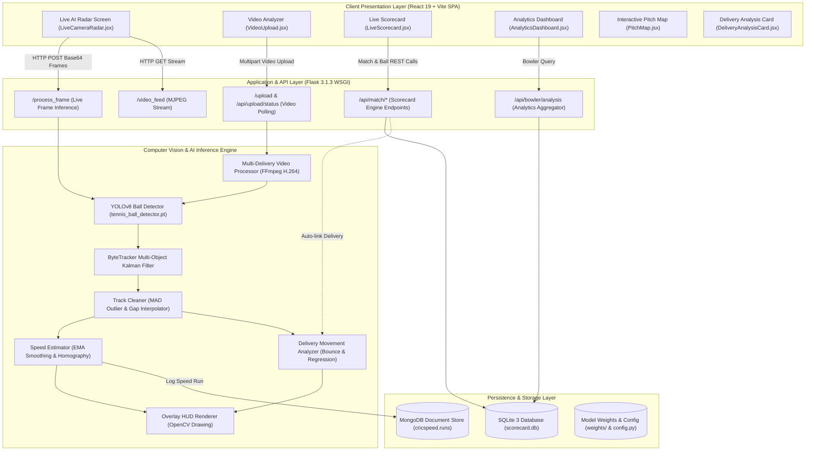
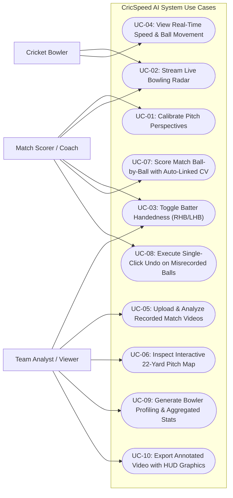
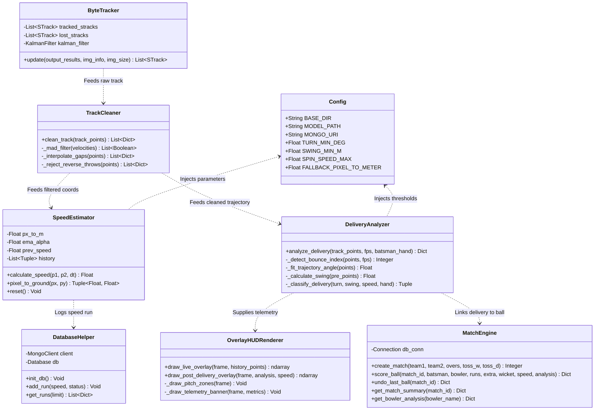
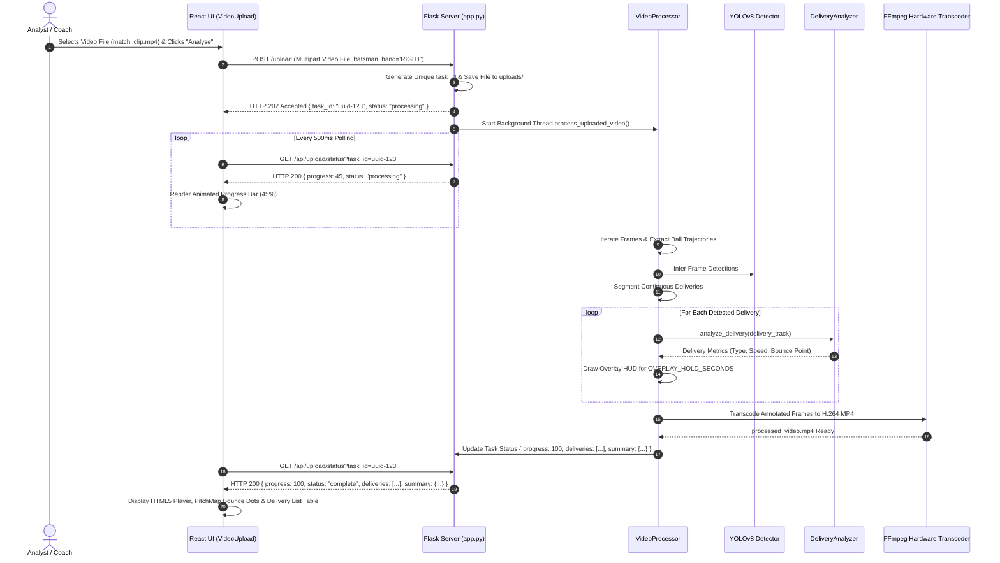
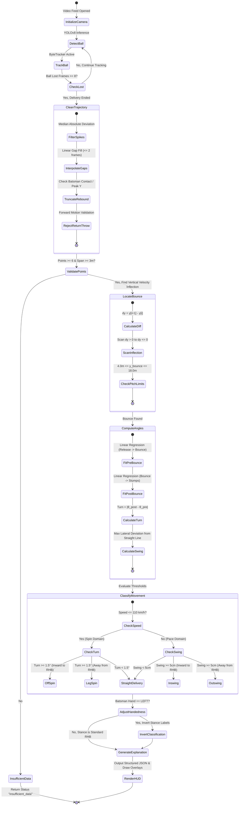
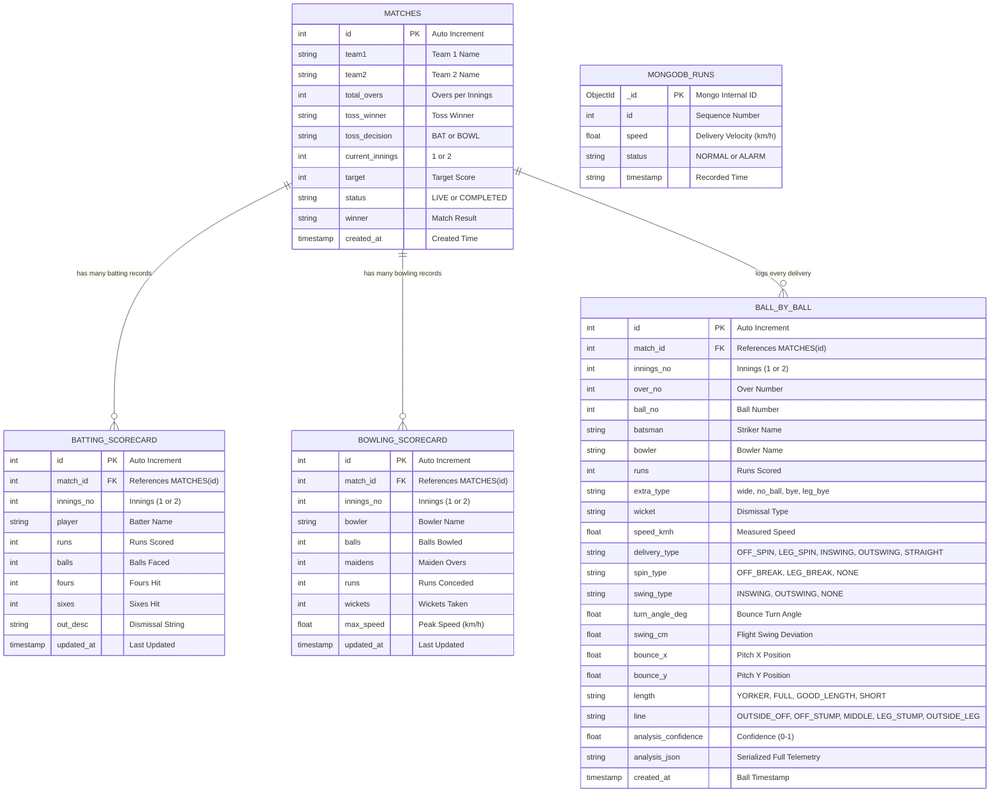

# CricSpeed AI: System Architecture & Design Diagrams

This document presents the complete architectural and behavioral modeling of the CricSpeed AI system using standard Mermaid diagrams accompanied by exhaustive technical explanations.

---

## 1. High-Level System Architecture Diagram



### Architectural Explanation
The architecture follows a decoupled, three-tier model:
- **Presentation Layer**: Built with React 19 and Vite, rendering dynamic dark glassmorphic dashboards. Client-side state manages active video streams, interactive pitch maps, batsman handedness toggle, and ball-by-ball scorecards.
- **Application & API Layer**: Flask serves as the central API gateway and WSGI streaming server. It exposes 26 RESTful routes and streaming endpoints handling live frame processing, multipart video uploads with asynchronous progress polling, and match engine state transitions.
- **AI & Computer Vision Engine**: Operates as a sequential pipeline: raw frames pass through YOLOv8 for tennis ball detection, ByteTracker associates ball detections across frames, `track_cleaning.py` removes spurious velocity spikes, and `delivery_analysis.py` computes turn, swing, bounce coordinates, and trajectory metrics.
- **Persistence Layer**: Employs a dual-database approach. SQLite provides ACID transactional guarantees for cricket scorecards and historical delivery analyses, while MongoDB logs high-frequency speed radar entries.

---

## 2. Use Case Diagram



### Explanation of Use Cases
- **Bowler**: Interacts primarily with the real-time speed radar to receive instant velocity feedback (km/h) and delivery classifications during practice net sessions.
- **Match Scorer / Coach**: Sets up match fixtures, selects toss decisions, toggles batsman handedness, records runs/extras/wickets, and relies on automated delivery linkage to attach AI telemetry to each legal ball. In case of user error, the single-click undo reverts match state cleanly.
- **Team Analyst / Viewer**: Uploads multi-delivery match footage, navigates deliveries via the interactive SVG pitch map, evaluates bowler consistency across pitch zones, and exports annotated MP4 videos with broadcast HUD telemetry.

---

## 3. Detailed Class Diagram



---

## 4. Sequence Diagram 1: Real-Time Live AI Radar & Delivery Analysis

```mermaid
sequenceDiagram
    autonumber
    actor User as User / Scorer
    participant UI as React UI (LiveCameraRadar)
    participant Flask as Flask Server (app.py)
    participant YOLO as YOLOv8 Detector
    participant Tracker as ByteTracker & Cleaner
    participant Analyzer as DeliveryAnalyzer
    participant SQLite as SQLite (scorecard.db)
    participant Mongo as MongoDB (cricspeed)

    User->>UI: Selects Batter Stance (e.g. 'RIGHT')
    loop Every Video Frame (~30-60 FPS)
        UI->>Flask: POST /process_frame (Base64 JPEG, batsman_hand='RIGHT')
        Flask->>YOLO: Detect Ball Bounding Box (conf=0.15)
        YOLO-->>Flask: Bounding Box Coordinates (x, y, w, h)
        Flask->>Tracker: Update Track History & Kalman Filter
        Tracker-->>Flask: Active Ball Trajectory Coordinates
        Flask->>Flask: SpeedEstimator.calculate_speed()
        alt Ball Delivery Completed (Lost for 8 frames)
            Flask->>Tracker: TrackCleaner.clean_track()
            Tracker-->>Flask: Filtered Smooth Trajectory
            Flask->>Analyzer: analyze_delivery(clean_track, fps, 'RIGHT')
            Analyzer->>Analyzer: Detect Bounce Inflection (dy > 0 -> dy <= 0)
            Analyzer->>Analyzer: Fit Pre & Post Bounce Linear Regression
            Analyzer->>Analyzer: Compute Turn (Δθ), Swing (cm), Length & Line
            Analyzer-->>Flask: Analysis Payload (OFF_SPIN, 3.8°, 85 km/h)
            Flask->>Mongo: add_run(85.0, 'NORMAL')
            Flask->>Flask: Cache delivery in memory (TTL = 60s)
        end
        Flask-->>UI: JSON { speed: 85.0, delivery_analysis: {...}, frame: "data:image/jpeg;..." }
        UI->>UI: Update Speed Dial, DeliveryAnalysisCard & Last 6 Strip
    end
    User->>UI: Clicks "Score 4 Runs"
    UI->>Flask: POST /api/match/ball { match_id: 1, runs: 4, batsman: "Player A", bowler: "Player B" }
    Flask->>SQLite: Save Ball Record & Auto-Link Cached Delivery Analysis
    SQLite-->>Flask: Ball Saved (ID: 12, Analysis Attached)
    Flask-->>UI: Updated Match State (Score, Overs, Bowler Figures)
```

---

## 5. Sequence Diagram 2: Video Upload, Polling & Multi-Delivery Extraction



---

## 6. Activity Diagram: Delivery Analytics & Movement Classification



---

## 7. Entity-Relationship Diagram (ERD)



### Explanation of Relational Modeling
- **Foreign Key Integrity**: Each match row in `matches` owns multiple batting records, bowling records, and individual ball-by-ball rows through foreign key references (`match_id` referencing `matches.id`).
- **Composite Unique Keys**: `UNIQUE(match_id, innings_no, player)` in `batting_scorecard` and `UNIQUE(match_id, innings_no, bowler)` in `bowling_scorecard` guarantee zero accidental duplicate rows per player per innings.
- **Delivery Analytics Integration**: The `ball_by_ball` table encapsulates both core cricket scoring metrics and deep computer vision telemetry, enabling direct correlation between bowling movement (turn angle, swing deviation, pitch length/line) and match outcomes (dot balls, boundaries, dismissals).
